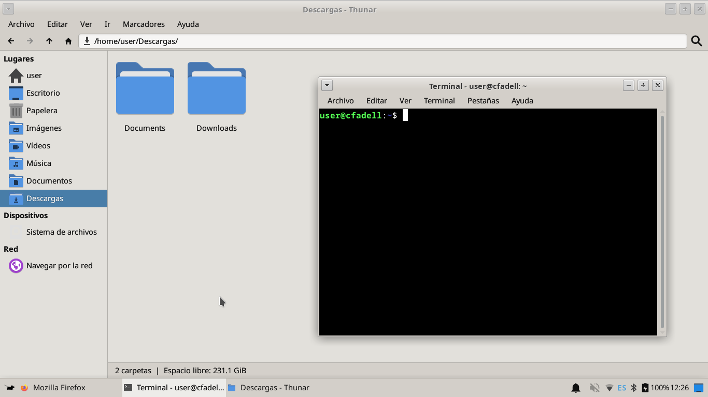

# roadrunner

GTK+ theme based on "Desert" by Paulxfce and "Greybird"



## What's included

- GTK 3 and GTK 4 (light and dark variants)
- xfwm4 window decorations
- GNOME Shell
- Xfce notifications (xfce-notify-4.0)

## Install

```sh
git clone https://github.com/antruc/roadrunner.git ~/.themes/roadrunner
```

Then pick **roadrunner** in GNOME Tweaks, or in Xfce:

```sh
xfconf-query -c xsettings -p /Net/ThemeName -s roadrunner
xfconf-query -c xfwm4 -p /general/theme -s roadrunner
```

Dark variant: enable "prefer dark" in your desktop settings, GTK picks up
`gtk-dark.css` automatically

## Notes

- Colors are defined once in `gtk-3.0/theme-colors/`; the gtk-4.0 files import
  them from there, so keep both folders together
- libadwaita apps ignore system GTK themes by design
